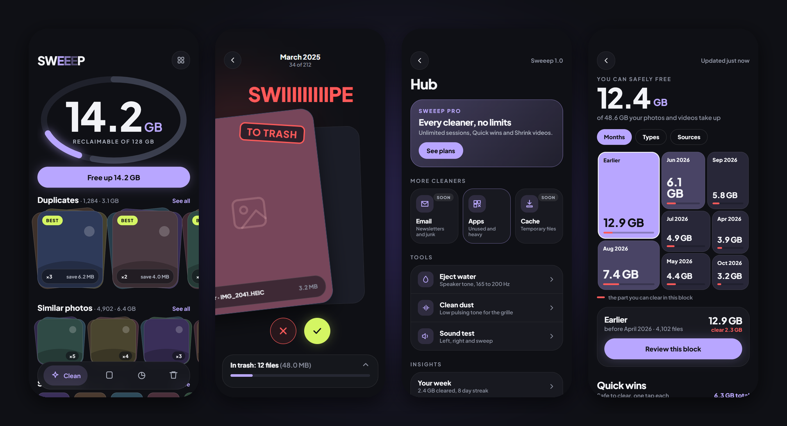
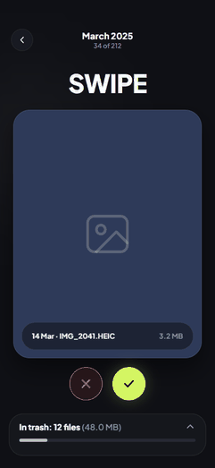
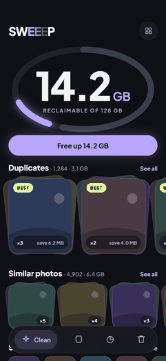
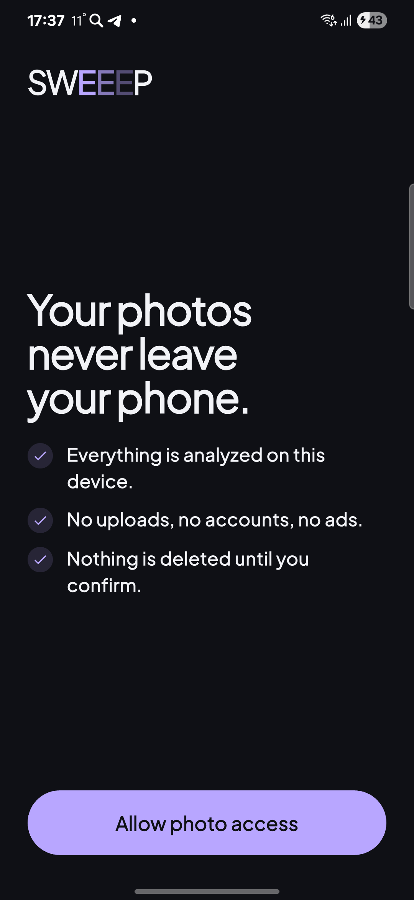
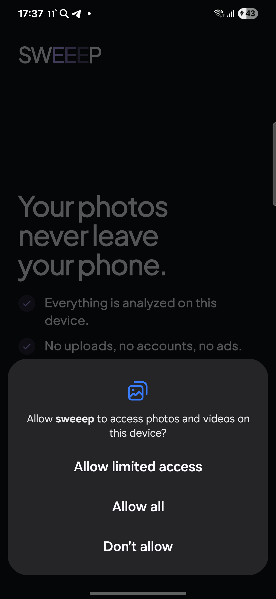
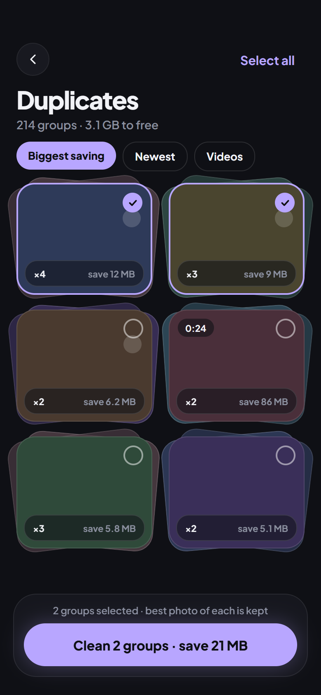
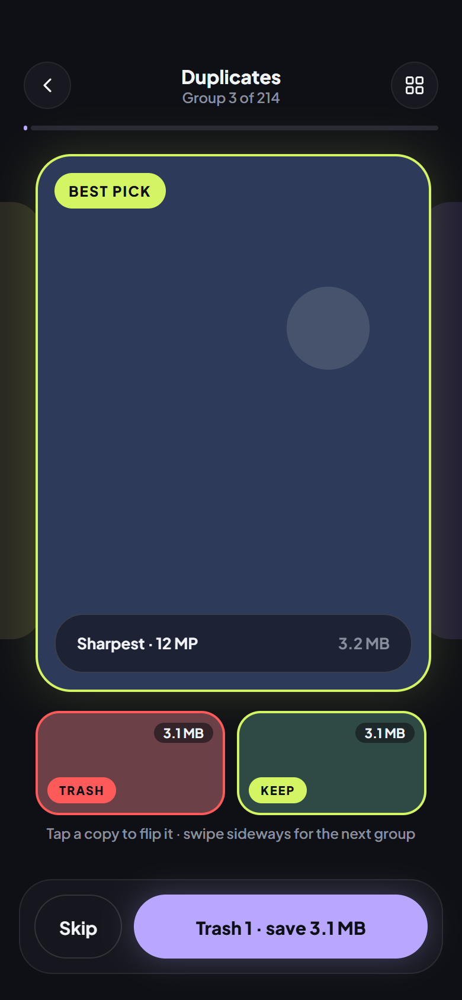
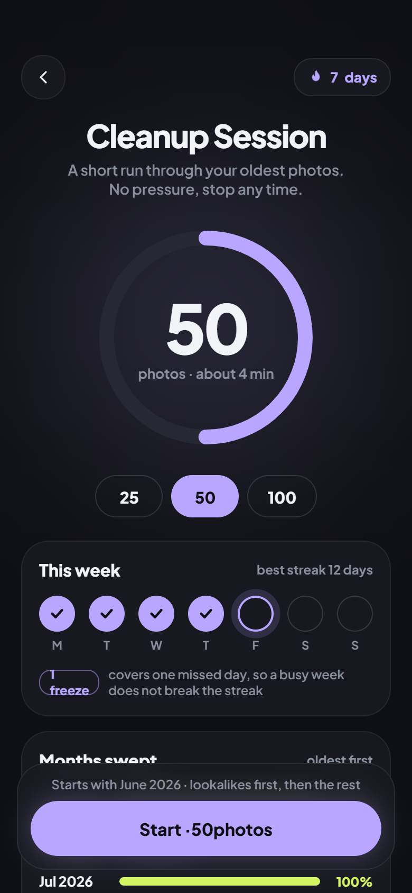
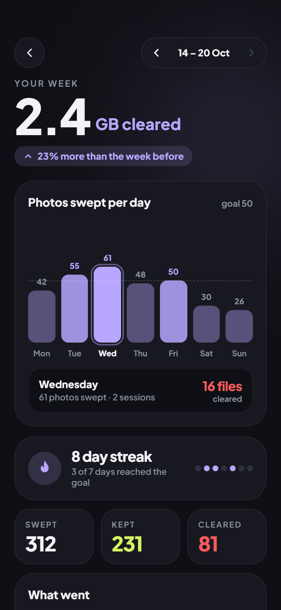

# SWEEEEP

**A photo and video cleaner that never sees your photos leave the phone.**
No AI, no cloud, no uploads, no account. Fingerprinting runs in a **Rust core** (perceptual hashes) behind a **Flutter** UI, and every number below was measured, not guessed.

<p align="center"></p>

<p align="center">
  
  &nbsp;&nbsp;
  
</p>

<sub>The hero image and the two GIFs come from the interactive design prototype the app is built from. Real device captures are further down. The prototype uses sample numbers.</sub>

> **Status:** Android works end to end (scan, groups, review, swipe, trash, system delete) and runs as a release build on a Samsung S23.
> iOS is designed in the spec but **not implemented**. Spec: [`docs/SPECIFICATION.md`](docs/SPECIFICATION.md) (Russian).

## Why it is interesting (the 60-second version)

|                                      |                                                                                                                                                                                                                                                                                                      |
| ------------------------------------ | ---------------------------------------------------------------------------------------------------------------------------------------------------------------------------------------------------------------------------------------------------------------------------------------------------- |
| **Fully on-device**                  | MediaStore index, thumbnails, hashes, groups and decisions live in a local SQLite file. The app has no network code path for photos.                                                                                                                                                                 |
| **Rust analysis core**               | aHash / dHash / pHash, Laplacian blur score, median brightness and SHA-256 in one FFI call (`sweeep_analyze`). 50k thumbnails hashed in 3.7 s on a desktop; ~3.2 ms per file on the phone.                                                                                                           |
| **Algorithm swap with numbers**      | A BK-tree over 64-bit hashes took ~44 s to group 50k photos at radius 8. Multi-index hashing (split the 64 bits into r+1 segments; two hashes within r must agree on one) does the same job in **0.27 s**. Both are in [`core/src`](core/src), the BK-tree is kept and tested.                       |
| **Resumable scan**                   | Hashes are checkpointed per batch. Killed at 2,432 of 10,658 files, the relaunch resumed from 2,432. An Android foreground service keeps the scan alive in the background; a delta re-sync with no changes takes 0.2 s.                                                                              |
| **Deletion you can trust**           | Swipe left only moves a file to an in-app soft trash (30 days). "Delete forever" goes through `MediaStore.createDeleteRequest` (one system confirmation per chunk) and the app only forgets files the system really deleted. Nothing is ever deleted automatically.                                  |
| **Product decisions backed by data** | Single-linkage grouping chained 15 dog photos from one park into a "Trash 14" suggestion. Fix: Hamming threshold 8 to 6, complete linkage, max 8 per group. Real library: largest group dropped from x15-18 to x8. Similar groups now default to **keep all**, exact duplicates to trash the extras. |
| **Tested**                           | 33 Rust tests, 60 Flutter tests (Drift migrations, grouping, review service, stats, localization parity, 100k-photo benchmarks).                                                                                                                                                                     |

## What it does

- **Duplicates and similar photos.** Exact copies by SHA-256 (only files of equal size are hashed), look-alikes by perceptual hash within a 5 s capture window, the sharpest frame preselected as best pick.
- **Blurry and dark frames** from Laplacian variance and median brightness.
- **Home feed.** A glowing reclaimable-space oval that collapses into a chip on scroll, carousels for Duplicates, Similar, Screenshots, Videos, Blurry & dark.
- **Group pager.** Swipe through groups, tap a copy to flip KEEP / TRASH ("KEEEEP ONE").
- **Swipe mode.** Left = trash, right = keep, Undo, a headline that stretches with the gesture (SWIIIIPE) and waves on delete (CLEAAAN).
- **Storage map.** Treemap of what takes space by month, type or source (Camera, chat apps), with safe "Quick wins" that open a filtered list instead of deleting in one tap.
- **Free by goal.** Say "I need 5 GB"; the app picks the safest files first, each file counted once, and you still review and untick before anything is trashed.
- **Cleanup session.** A short daily deck (look-alikes first), streak with one forgiven day a week, month progress, optional daily reminder.
- **Month wrap and weekly report.** Recap cards you can save as an image to the Sweeep folder (never shared automatically); a Monday-Sunday report built from a local daily-stats table.
- **Home screen widgets.** Three Android widgets drawn as bitmaps with the app's font. They receive only numbers and short texts, never photos or file names.
- **App cleaner.** Lists launcher apps by size and last use, uninstalls one at a time through the system dialog. Optional Usage access for sizes and "unused" detection; without it only apk sizes are shown.
- **Tools.** Speaker tone generators (eject water, clean dust, sound test).
- English, Russian and Italian UI (follows the phone, switchable in Hub). Dark "Obsidian + Lavender" design with one colour role per action: lime = keep, coral = trash.

## On a real phone

<sub>Release build on a Samsung S23 with the author's own library (48 GB of photos and videos). Only screens without personal photos are shown.</sub>

<p>
  
  
  
</p>

More: [`docs/goal-shots`](docs/goal-shots), [`docs/nav-shots`](docs/nav-shots), [`docs/wrap-shots`](docs/wrap-shots), [`docs/apps-shots`](docs/apps-shots) (device vs prototype side by side). Prototype screens:

<p>
  
  
  
  
</p>

## Numbers

Samsung S23 (SM-S911B), Android 15, release build, **10,658 files**:

| Step                           | Result                                        |
| ------------------------------ | --------------------------------------------- |
| MediaStore full index          | 2.2 s                                         |
| Delta re-sync, no changes      | 0.2 s                                         |
| Gray thumbnail 128 px          | ~22 ms each                                   |
| Perceptual hashing (Rust, FFI) | 34.5 s total, ~3.2 ms/file                    |
| Found                          | 12 exact-duplicate groups, 766 similar groups |

Rust core on a desktop, 50k thumbnails: hashing 3.7 s; grouping 16 ms (5 s window) or 0.27 s (global, multi-index).
SQL side on a synthetic 100k-photo library: Home load 262 to 145 ms, Timeline 372 to 92 ms after an index and a range scan instead of a window function. Details and what is **not** measured yet: [`docs/benchmarks.md`](docs/benchmarks.md).

## Architecture

```
 Flutter UI (Riverpod)
   features/  home swipe groups storage session week widgets apps ...
        |
   index/     services: scan, analysis, groups, review, stats   (pure Dart, unit-tested)
        |                         |
   Drift / SQLite            dart:ffi ---> Rust core (core/)
   assets, hashes,                          aHash dHash pHash, Laplacian,
   groups, decisions,                       SHA-256, grouping (windowed or
   trash_items, sessions,                   multi-index hashing)
   daily_stats, scan_state
        |
   Pigeon + MethodChannels ---> Kotlin: MediaStore, createDeleteRequest,
                                foreground scan service, widgets, reminder,
                                app list / uninstall, tone generator
```

- **Why Rust for analysis:** tight loops over 128 px thumbnails and 64-bit hashes; one FFI call per batch of 64.
- **Why the database is the checkpoint:** every stage writes its result (`hashes` carries an `analysisVersion` so a better algorithm can force re-analysis), so a killed scan resumes instead of restarting.
- **Schema migrations** are tested, including dropping a removed feature's tables.
- **Layout:** `core/` Rust crate (`cargo test`), `app/` Flutter project, `scripts/` Android build of the core, `docs/` spec, dev log, benchmarks.

## Try it

**One minute, no phone needed** (Rust core and tests):

```bash
cd core
cargo test                               # 33 tests
cargo run --release --example bench      # 50k-thumbnail throughput, windowed vs multi-index grouping
```

**Full app on an Android device or emulator** (Flutter 3.47, Android SDK, Rust with the Android targets):

```bash
rustup target add aarch64-linux-android
bash scripts/build_core_android.sh       # builds libsweeep_core.so into the Android project
cd app
flutter pub get
dart run pigeon --input pigeon/media_api.dart
dart run build_runner build
flutter analyze && flutter test          # 60 tests
flutter run --release
```

Generated files (`*.g.dart`, `Messages.g.*`) and the `.so` files are git-ignored; regenerate after a fresh clone.
Safe by default: a build flag (`sweeep.directDelete`) that skips the system delete dialog exists for sideload testing and is `false`.

## Limitations and roadmap

Honest list of what is missing:

- **iOS is not implemented** (Swift / PhotoKit is specified only). Android below 11 has no delete flow.
- **Pro / paywall is a stub.** No billing code; store billing is still to be done.
- **Email cleaner and Cache cleaner** are placeholders marked "soon" in the Hub.
- **Not measured yet:** peak memory, fps and cold start with 50k+ photos on the phone; foreground-service battery cost; upgrade of an old database on a device beyond what migration tests cover.
- **Italian strings** have not been reviewed by a native speaker.
- **Global multi-index grouping** is implemented and benchmarked in the core, while the app currently groups within a 5 s capture window (a burst-oriented rule).
- A Moments feature (events by time and place) was built, then **removed** after testing; schema 6 cleans up its tables.
- Ideas, not built: swipe order options, shrink videos. See [`docs/IDEAS.md`](docs/IDEAS.md).

## Docs

[`SPECIFICATION.md`](docs/SPECIFICATION.md) (Russian) - [`DEVLOG.md`](docs/DEVLOG.md) (phase notes and device measurements) - [`benchmarks.md`](docs/benchmarks.md) - [`visual-audit.md`](docs/visual-audit.md) - [`prototype-diff.md`](docs/prototype-diff.md)
